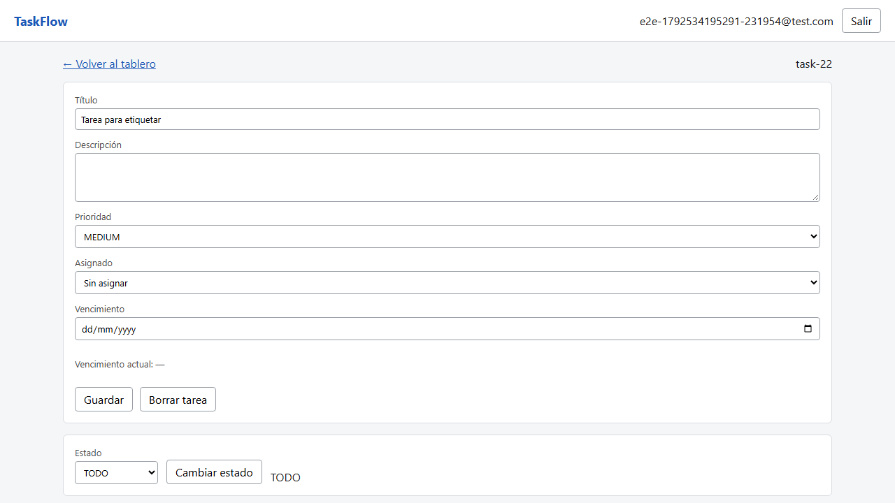

**Criterio violado:** US-15 c1: "Las etiquetas se guardan normalizadas a minúsculas y sin espacios al inicio ni al final"

**Entorno:** Windows 10/11 (`win32`) · Chromium 156.0.8078.4 (Playwright 1.64.0, `Desktop Chrome`) · zona horaria `America/Montevideo` (UTC−3) en el navegador (`timezoneId`) y en la API (`TZ`) · API `http://localhost:3000`, cliente Vite `http://localhost:5173` · SQLite sembrada con `npm run db:reset` · commit `f368466` (corrida del 03/11/2026); la causa sigue presente en `main` (`d08590f`, 17/11/2026)

**Datos / precondiciones:** Base sembrada (`npm run db:reset`). El test registra un usuario nuevo desde la UI (`e2e-<marca>@test.com` / `Password1`), crea un proyecto `Proyecto E2E <marca>` y una tarea dentro. Tarea: `Tarea para etiquetar`.

**Pasos:**
1. Iniciar sesión y abrir el detalle de la tarea `Tarea para etiquetar`.
2. Escribir `Backend` en el campo de etiqueta y tocar **Agregar** (`POST /api/tasks/<taskId>/tags` con `{ "name": "Backend" }`).
3. Mirar el chip de la etiqueta en el detalle.

**Esperado:** La etiqueta queda registrada como `backend`.

**Obtenido:** La API responde `201` y guarda `Backend`; el chip muestra `Backend`. Causa: `addTag` (`server/src/modules/tasks/tasks.service.ts:192`) sólo aplica `trim()`, nunca `toLowerCase()`.

**Reproducibilidad:** 2 de 2 (corrida y reintento automático de Playwright, 03/11/2026). No depende de la zona horaria ni del navegador: el valor se guarda así en la API.

Para reproducirlo en un comando:
```sh
npx playwright test e2e/us15-etiquetas.spec.ts -g "US-15 c1" --project=chromium
```

**Evidencia:**
- Error de Playwright: `Expected: "backend" / Received: "Backend"` en `getByTestId('tag-chip-name')` → [error-context.md](https://github.com/CabreraClau/taskflow_2026_s2/blob/main/test-results/us15-etiquetas-US-15-%C2%B7-Eti-88664-da-normalizada-a-min%C3%BAsculas-chromium/error-context.md)
- Traza del reintento (`npx playwright show-trace`): [trace.zip](https://github.com/CabreraClau/taskflow_2026_s2/blob/main/test-results/us15-etiquetas-US-15-%C2%B7-Eti-88664-da-normalizada-a-min%C3%BAsculas-chromium-retry1/trace.zip)
- Captura del fallo:

  

**Test que lo reproduce:** `e2e/us15-etiquetas.spec.ts` › `US-15 c1 · Al agregar la etiqueta "Backend" se guarda normalizada a minúsculas`

**Severidad:** media

Ficha en el repo: [docs/bugs](https://github.com/CabreraClau/taskflow_2026_s2/tree/main/docs/bugs) (BUG-01).
