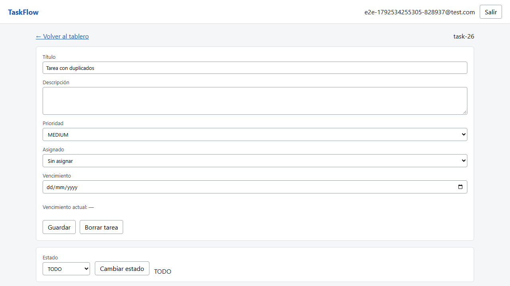

**Criterio violado:** US-15 c3: "Una tarea no puede tener la misma etiqueta más de una vez; volver a agregarla devuelve HTTP 200 y no genera un duplicado"

**Entorno:** Windows 10/11 (`win32`) · Chromium 156.0.8078.4 (Playwright 1.64.0, `Desktop Chrome`) · zona horaria `America/Montevideo` (UTC−3) en el navegador (`timezoneId`) y en la API (`TZ`) · API `http://localhost:3000`, cliente Vite `http://localhost:5173` · SQLite sembrada con `npm run db:reset` · commit `f368466` (corrida del 03/11/2026); la causa sigue presente en `main` (`d08590f`, 17/11/2026)

**Datos / precondiciones:** Base sembrada (`npm run db:reset`). El test registra un usuario nuevo desde la UI (`e2e-<marca>@test.com` / `Password1`), crea un proyecto `Proyecto E2E <marca>` y una tarea dentro. Tarea: `Tarea con duplicados`.

**Pasos:**
1. Abrir el detalle de la tarea `Tarea con duplicados`.
2. Agregar la etiqueta `bug` (responde `201`).
3. Agregar otra vez la etiqueta `bug`.
4. Contar los chips de etiqueta del detalle.

**Esperado:** El segundo pedido responde `200` y la tarea sigue con una sola etiqueta `bug`.

**Obtenido:** El segundo pedido responde `201` y la tarea muestra dos chips `bug`. Causa: `addTag` (`server/src/modules/tasks/tasks.service.ts:192`) crea siempre un `taskTag` nuevo y el controller (`server/src/modules/tasks/tasks.controller.ts:95`) responde siempre `201`.

**Reproducibilidad:** 2 de 2 (corrida y reintento automático de Playwright, 03/11/2026). No depende de la zona horaria ni del navegador.

Para reproducirlo en un comando:
```sh
npx playwright test e2e/us15-etiquetas.spec.ts -g "US-15 c3" --project=chromium
```

**Evidencia:**
- Error de Playwright: `Expected: 1 / Received: 2` en `getByTestId('tag-chip')` → [error-context.md](https://github.com/CabreraClau/taskflow_2026_s2/blob/main/test-results/us15-etiquetas-US-15-%C2%B7-Eti-0d66c--200-y-no-genera-duplicados-chromium/error-context.md)
- Traza del reintento (`npx playwright show-trace`): [trace.zip](https://github.com/CabreraClau/taskflow_2026_s2/blob/main/test-results/us15-etiquetas-US-15-%C2%B7-Eti-0d66c--200-y-no-genera-duplicados-chromium-retry1/trace.zip)
- Captura del fallo:

  

**Test que lo reproduce:** `e2e/us15-etiquetas.spec.ts` › `US-15 c3 · Agregar la misma etiqueta dos veces devuelve 200 y no genera duplicados`

**Severidad:** media

Ficha en el repo: [docs/bugs](https://github.com/CabreraClau/taskflow_2026_s2/tree/main/docs/bugs) (BUG-03).
