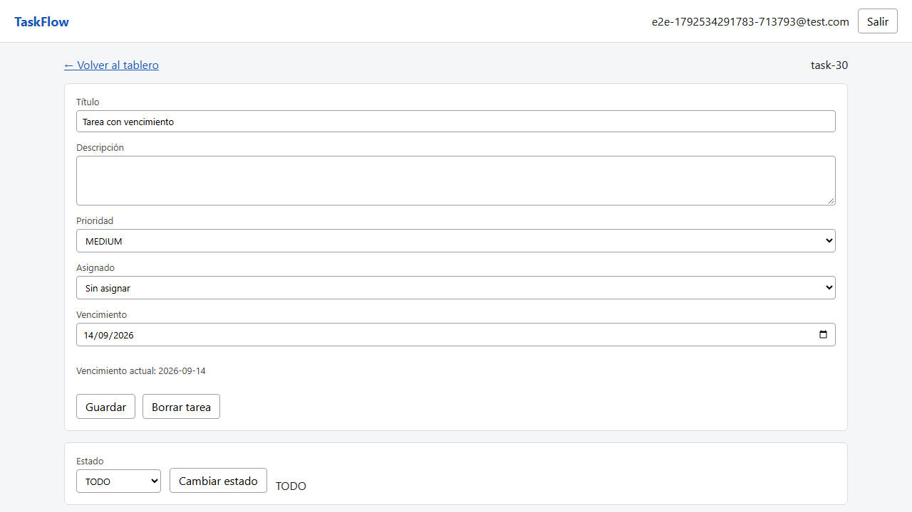

**Criterio violado:** US-16 c3: "La fecha que se devuelve es siempre la misma que se cargó, sin importar la zona horaria del cliente ni la del servidor"

**Entorno:** Windows 10/11 (`win32`) · Chromium 156.0.8078.4 (Playwright 1.64.0, `Desktop Chrome`) · zona horaria `America/Montevideo` (UTC−3) en el navegador (`timezoneId`) y en la API (`TZ`) · API `http://localhost:3000`, cliente Vite `http://localhost:5173` · SQLite sembrada con `npm run db:reset` · commit `f368466` (corrida del 03/11/2026); la causa sigue presente en `main` (`d08590f`, 17/11/2026)

**Datos / precondiciones:** Base sembrada (`npm run db:reset`). El test registra un usuario nuevo desde la UI (`e2e-<marca>@test.com` / `Password1`), crea un proyecto `Proyecto E2E <marca>` y una tarea dentro. Tarea: `Tarea con vencimiento`. La API corre con `TZ=America/Montevideo`.

**Pasos:**
1. Abrir el detalle de la tarea `Tarea con vencimiento`.
2. Cargar `2026-09-15` en el campo de vencimiento y tocar **Guardar** (`PATCH /api/tasks/<taskId>` con `{ "dueDate": "2026-09-15" }`).
3. Leer `dueDate` en la respuesta y el valor que muestra el detalle.

**Esperado:** La respuesta y la UI muestran `2026-09-15`.

**Obtenido:** La API responde `200` con `"dueDate": "2026-09-14"`. Causa: `parseDueDate` (`server/src/lib/ids.ts:38`) toma la fecha como medianoche UTC y `formatDueDate` (`server/src/lib/ids.ts:42`) la formatea con los getters locales, restando el offset.

**Reproducibilidad:** 2 de 2 con la API en `America/Montevideo` (UTC−3), corrida y reintento automático del 03/11/2026. Depende de la zona horaria del **servidor**: por la causa, se espera que no se reproduzca con la API en UTC o en una zona positiva (no verificado). Por eso `playwright.config.ts` fija `TZ=America/Montevideo`.

Para reproducirlo en un comando:
```sh
npx playwright test e2e/us16-vencimiento.spec.ts -g "US-16 c2/c3" --project=chromium
```

**Evidencia:**
- Error de Playwright: `Expected: "2026-09-15" / Received: "2026-09-14"` → [error-context.md](https://github.com/CabreraClau/taskflow_2026_s2/blob/main/test-results/us16-vencimiento-US-16-%C2%B7-F-2438c-orrimiento-por-zona-horaria-chromium/error-context.md)
- Traza del reintento (`npx playwright show-trace`): [trace.zip](https://github.com/CabreraClau/taskflow_2026_s2/blob/main/test-results/us16-vencimiento-US-16-%C2%B7-F-2438c-orrimiento-por-zona-horaria-chromium-retry1/trace.zip)
- Captura del fallo:

  

**Test que lo reproduce:** `e2e/us16-vencimiento.spec.ts` › `US-16 c2/c3 · La fecha cargada se devuelve igual, sin corrimiento por zona horaria`

**Severidad:** alta

Ficha en el repo: [docs/bugs](https://github.com/CabreraClau/taskflow_2026_s2/tree/main/docs/bugs) (BUG-04).
