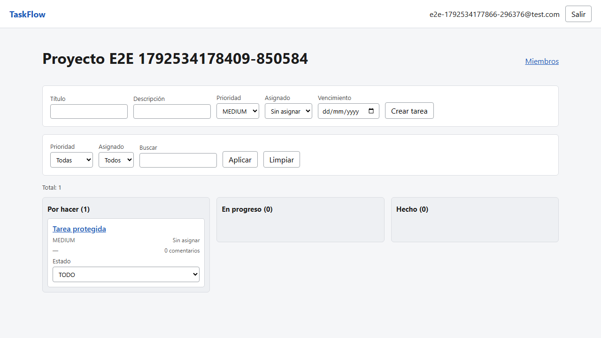

**Criterio violado:** US-12 c5: "Solo los miembros del proyecto al que pertenece la tarea pueden editarla (HTTP 403)"

**Entorno:** Windows 10/11 (`win32`) · Chromium 156.0.8078.4 (Playwright 1.64.0, `Desktop Chrome`) · zona horaria `America/Montevideo` (UTC−3) en el navegador (`timezoneId`) y en la API (`TZ`) · API `http://localhost:3000`, cliente Vite `http://localhost:5173` · SQLite sembrada con `npm run db:reset` · commit `f368466` (corrida del 03/11/2026); la causa sigue presente en `main` (`d08590f`, 17/11/2026)

**Datos / precondiciones:** Base sembrada (`npm run db:reset`). El test registra un usuario nuevo desde la UI (`e2e-<marca>@test.com` / `Password1`), crea un proyecto `Proyecto E2E <marca>` y una tarea dentro. Tarea: `Tarea protegida`. Usuario ajeno: `caro@test.com` / `Password1` (del seed), que **no** es miembro de ese proyecto.

**Pasos:**
1. Crear como usuario A el proyecto y la tarea `Tarea protegida`.
2. `POST /api/auth/login` con `caro@test.com` / `Password1` y guardar su token.
3. `PATCH /api/tasks/<taskId>` con `Authorization: Bearer <token de caro>` y `{ "title": "Cambiado por un ajeno" }`.

**Esperado:** `403 FORBIDDEN` y la tarea conserva su título.

**Obtenido:** `200` y el título cambia a `Cambiado por un ajeno`. Causa: `PATCH /tasks/:taskId` (y `DELETE`) en `server/src/modules/tasks/tasks.routes.ts:14` no usa `requireTaskProjectMember`, y `updateTask` sólo valida membresía al cambiar `status`.

**Reproducibilidad:** 2 de 2 (corrida y reintento automático de Playwright, 03/11/2026). No depende de la zona horaria ni del navegador: el pedido va directo a la API.

Para reproducirlo en un comando:
```sh
npx playwright test e2e/us12-editar.spec.ts -g "US-12 c5" --project=chromium
```

**Evidencia:**
- Error de Playwright: `Expected: 403 / Received: 200` → [error-context.md](https://github.com/CabreraClau/taskflow_2026_s2/blob/main/test-results/us12-editar-US-12-%C2%B7-Editar-d4b6b--puede-editar-la-tarea-403--chromium/error-context.md)
- Traza del reintento (`npx playwright show-trace`): [trace.zip](https://github.com/CabreraClau/taskflow_2026_s2/blob/main/test-results/us12-editar-US-12-%C2%B7-Editar-d4b6b--puede-editar-la-tarea-403--chromium-retry1/trace.zip)
- Captura del fallo:

  

**Test que lo reproduce:** `e2e/us12-editar.spec.ts` › `US-12 c5 · Un usuario ajeno al proyecto no puede editar la tarea (403)`

**Severidad:** alta

**Criterio de cierre:** aplicar la autorización en el servidor a todos los campos editables. Verificar que una denegación no altere la tarea y que la edición de un miembro siga funcionando.

Ficha en el repo: [docs/bugs](https://github.com/CabreraClau/taskflow_2026_s2/tree/main/docs/bugs) (BUG-05).
